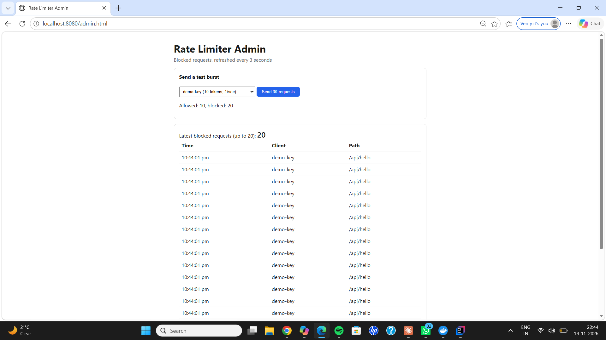
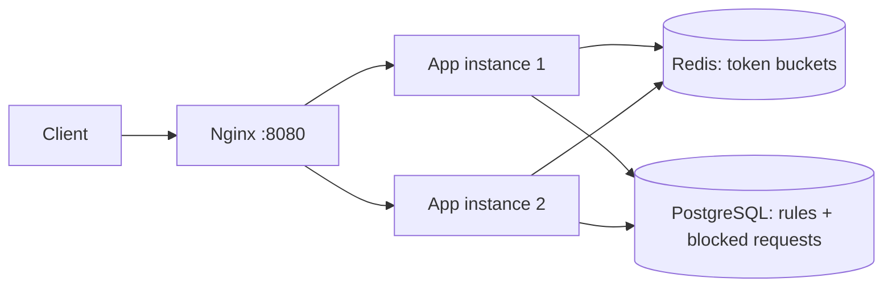

# Distributed Rate Limiter Service


A rate limiter for HTTP APIs that enforces per-client limits **across multiple application instances**. Built with Java 21, Spring Boot, Redis (atomic Lua token bucket), PostgreSQL, Docker and Nginx.



## How it works



1. Every request to `/api/**` passes through a servlet filter that reads the `X-API-Key` header.
2. The client's limits (capacity and refill rate) come from PostgreSQL, cached in memory for 60 seconds so the database is not on the hot path.
3. A **Lua script running inside Redis** refills the client's token bucket and takes one token in a single atomic step. Because both app instances talk to the same Redis, the limit is global.
4. Allowed requests continue. Blocked requests get **HTTP 429** with `Retry-After`, `X-RateLimit-Limit` and `X-RateLimit-Remaining` headers, and are recorded in PostgreSQL by a background thread.

## Run it

```
docker compose up -d --build
```

- API: `http://localhost:8080/api/hello` (send header `X-API-Key: demo-key` or `premium-key`)
- Admin page: `http://localhost:8080/admin.html`
- Response header `X-Served-By` shows which app instance answered.

```
curl.exe -i -H "X-API-Key: demo-key" http://localhost:8080/api/hello
```

| Client | Capacity | Refill |
|---|---|---|
| demo-key | 10 | 1 token/sec |
| premium-key | 100 | 10 tokens/sec |

## Results

**Load test (k6, 200 requests/sec for 10 seconds, 2 app instances behind Nginx, one client):**

| Metric | Result |
|---|---|
| Requests sent | 2,000 |
| Allowed (200) | 19 |
| Blocked (429) | 1,981 |
| Failed requests | 0% |
| Latency | avg 20.6 ms, p95 58 ms |

A 10-token bucket refilling at 1 token/sec should allow about 20 requests in 10 seconds. Two independent per-instance counters would have allowed about 40.

**Concurrency test (Testcontainers + real Redis):** 400 requests from 100 threads against a 50-token bucket allowed **exactly 50**.

Run the load test yourself:

```
docker run --rm -v "${PWD}/k6:/scripts" -e BASE_URL=http://host.docker.internal:8080 grafana/k6 run /scripts/loadtest.js
```

## Design decisions

- **Token bucket in a Lua script.** Redis runs the script atomically, so two instances can never spend the same token. It also uses Redis's own clock (`TIME`), so instances with different system clocks cannot disagree.
- **Fail open.** If Redis is unavailable, requests are allowed and the error is logged, so a limiter outage does not take the API down.
- **Cached rules.** Rules are read from PostgreSQL and cached for 60 seconds. Rule changes can take up to a minute to apply.
- **Async audit log.** Blocked requests are written on a background thread, so a slow database never slows a 429 response.
- **Idle buckets expire.** Each bucket key gets a TTL, so inactive clients are removed from Redis automatically.

## Known limitations

- `/admin/**` is not authenticated (local demo only).
- A single Redis instance is a single point of failure; production would use Redis Sentinel or Cluster.
- Rule caches are per instance and are not invalidated across instances.

## Tech stack

Java 21, Spring Boot, Spring Data Redis (Lettuce), PostgreSQL + Flyway, Redis, Docker Compose, Nginx, JUnit 5, Testcontainers, k6, GitHub Actions.

## Tests

```
mvn test
```